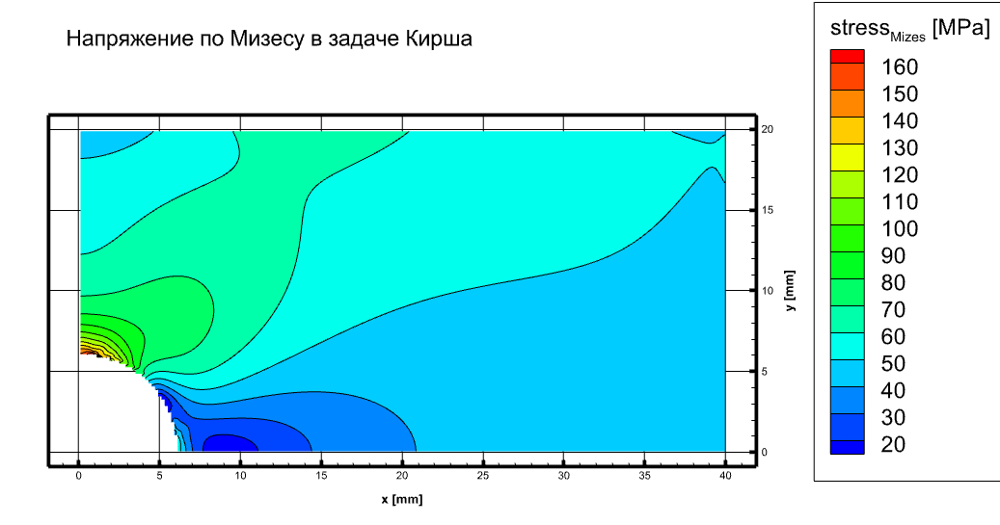

#AliceFlow 3D#

AliceFlow 3D - это калькулятор тепловых полей, гидродинамики и механики (линейной) на прямоугольных декартовых сетках.

Вибрационная конвекция 3D

Линейная стационарная Механика

Системные требования - в системе должен быть установлен Tecplot 360 EX 2023 R1.

Требования к оборудованию: необходима карта nvidia не обязательно профессиональная для использования в вычислениях. 

Интерфейс написан на языке Паскаль. Ядро солвера написано на С/С++ (Microsoft Visual Studio 2019 community, Cuda Toolkit 10.2).

Программа работает под ОС Win 10 x64

Программа не имеет статуса релиза. Используйте на свой страх и риск.
