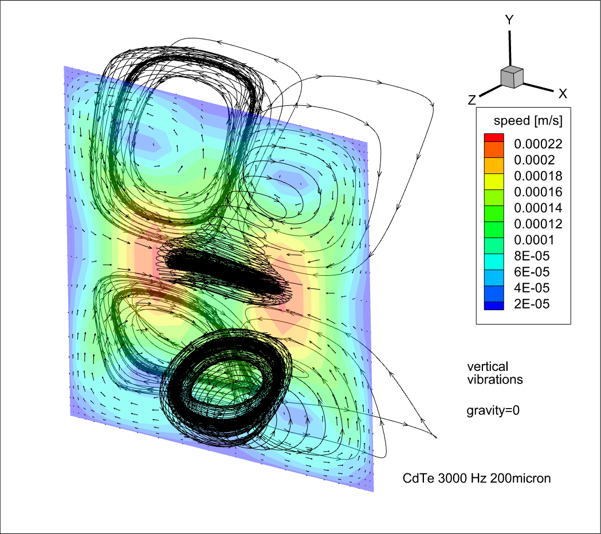

AliceFlow 3D

AliceFlow 3D - это калькулятор тепловых полей, гидродинамики и механики (линейной) на прямоугольных декартовых сетках.

Программа не имеет статуса релиза. Используйте на свой страх и риск.
